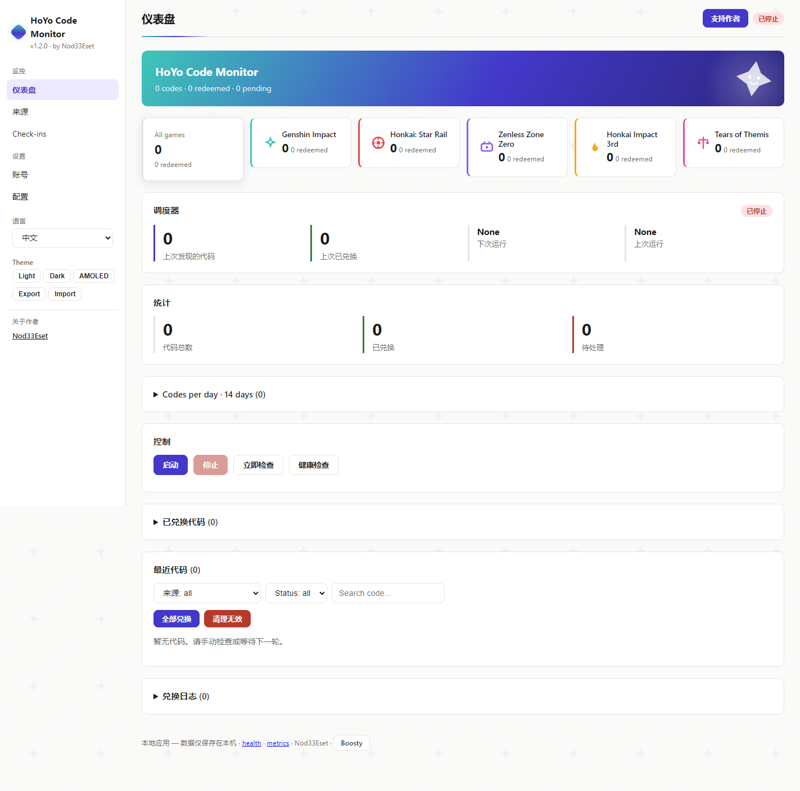
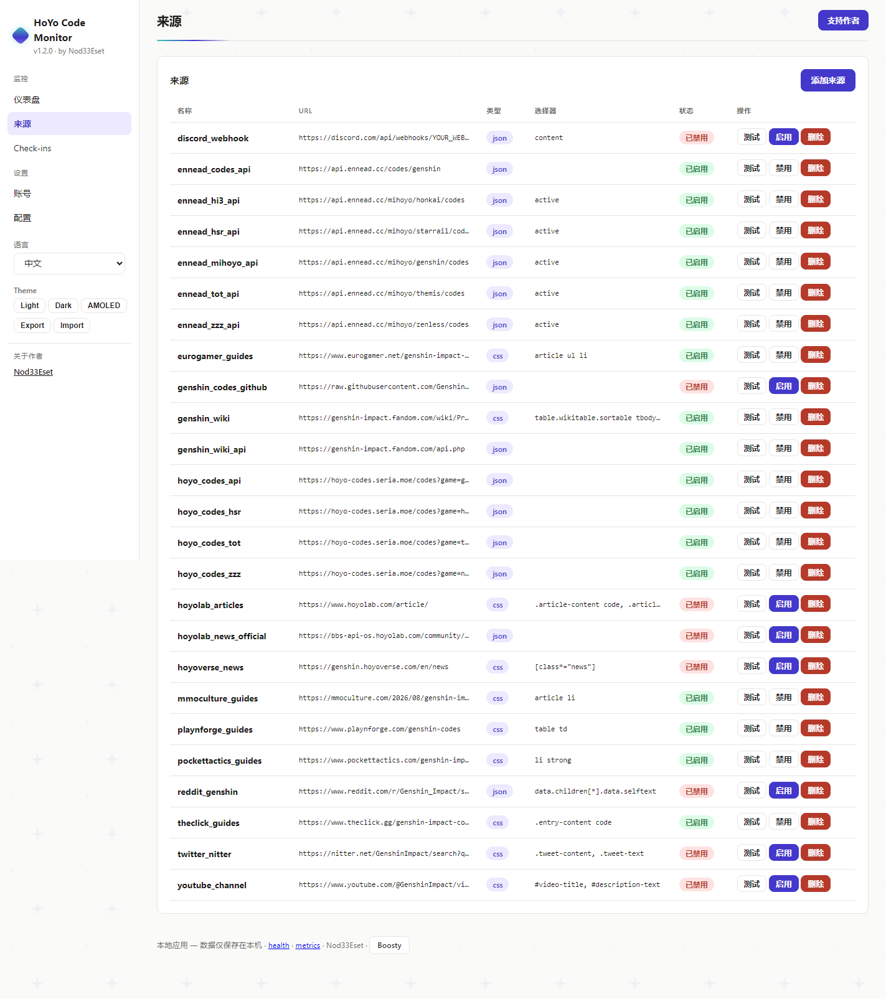
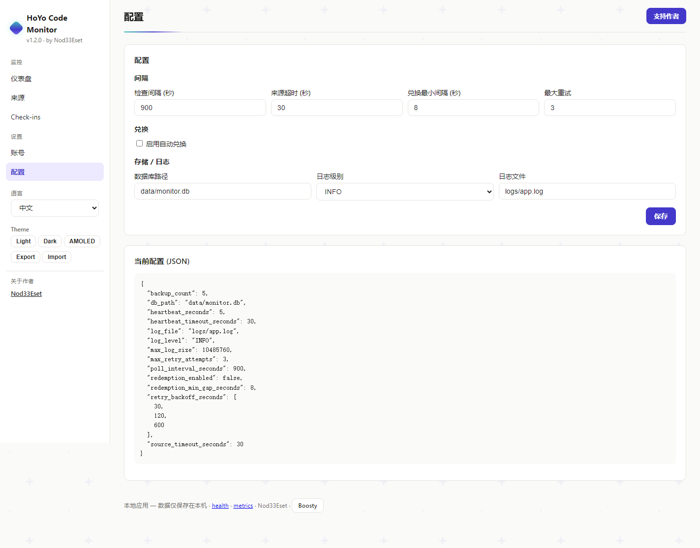
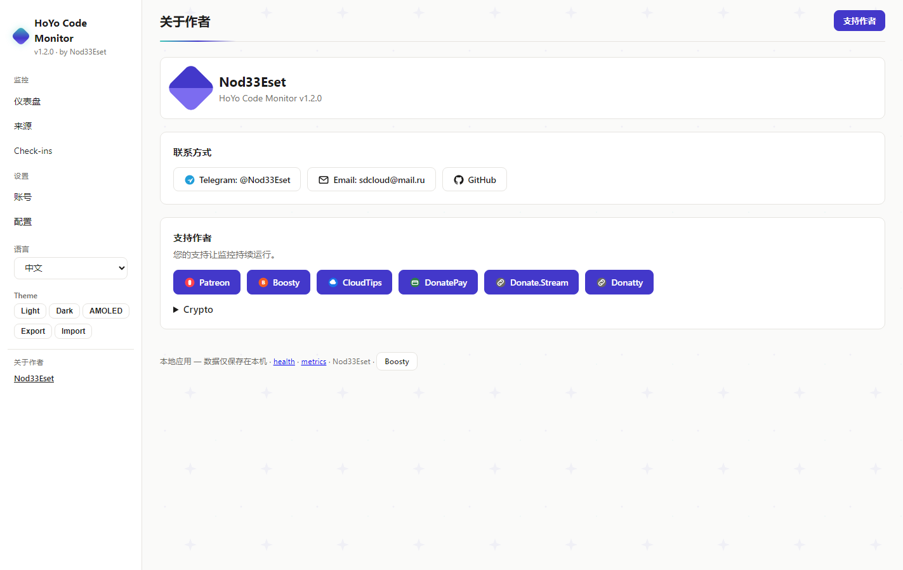
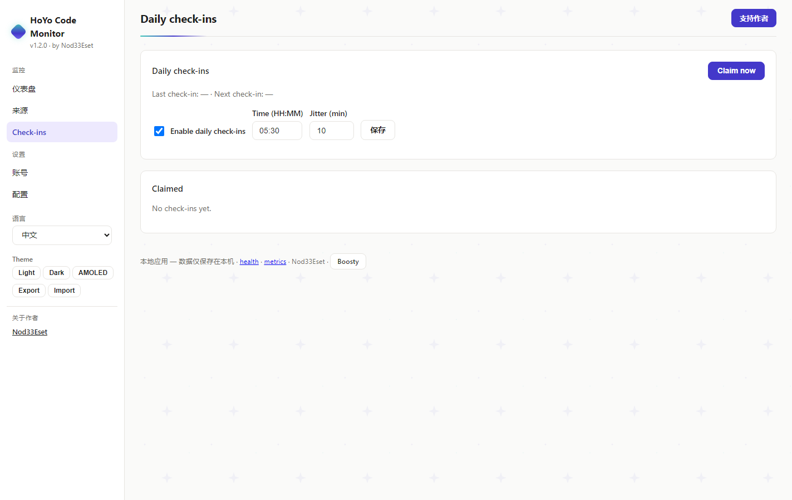
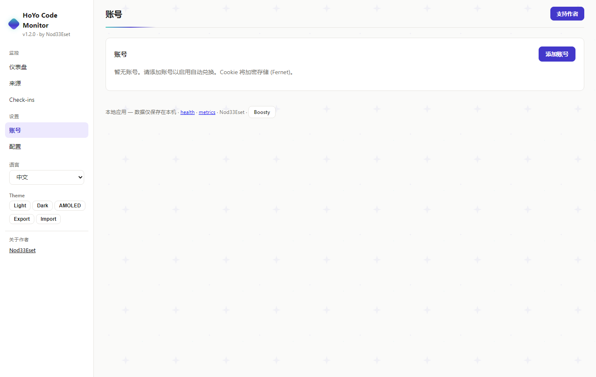

# HoYo Code Monitor

[](https://github.com/retvil/hoyo-code-monitor/releases) [](LICENSE) [](https://github.com/retvil/hoyo-code-monitor/releases)

**再也不错过 HoYoverse 兑换码 —— 5 款游戏的本地监控与自动兑换，就在你的电脑上。**

[🇬🇧 English](README.md) | [🇷🇺 Русский](README.ru.md) | [🇩🇪 Deutsch](README.de.md) | [🇫🇷 Français](README.fr.md) | [🇯🇵 日本語](README.ja.md) | **🇨🇳 中文**

## 这是什么？

HoYoverse 游戏会定期发布限时兑换码 —— 而且很快过期。**HoYo Code Monitor** 监控 5 款游戏 (原神、崩坏：星穹铁道、绝区零、崩坏3、Tears of Themis (未定事件簿)) 的 16 个兑换码来源，并自动为你的账号兑换新码。全部在本机运行：SQLite 数据库、加密 Cookie，无遥测，无云端。

### 工作原理

1. 调度器抓取已启用的来源，提取兑换码 (`[A-Z0-9]{8,14}`) 并保存新增。
2. 对每个开启自动兑换的账号：携带账号 Cookie 调用 `GET webExchangeCdkey`，兑换间隔可配置（默认 8 秒）。
3. 记录结果：`success` → Done + 奖励；`-2017/-2018` → 已兑换过 (记为 Done)；`-2001` 已过期，`-2003` 无效/仅限国服。
4. HoYoLAB 每日签到按独立计划执行 (默认 04:00 + 抖动)：每个账号 × 游戏 `info → sign → home`，使用相同 Cookie，结果见 Check-ins 页面。
5. 若签到因 Cookie 过期失败，调度器可**以无头方式自动从已保存的浏览器配置文件刷新 Cookie**（可选项，按账号冷却）——只要保存的会话仍有效，就无需手动重新登录。

## 安全审计 (v1.6.0)

v1.6.0 审计修复了 45 个不同严重级别的问题。主要变更：

| 领域 | 变更 |
|---|---|
| **SSRF** | 解析到私有网段 (10.x, 172.16–31.x, 192.168.x, 127.x, 169.254.x, 0.0.0.0) 或使用非 HTTP 协议的来源 URL 在创建/更新时被拒绝 |
| **ReDoS** | 包含嵌套量词 (`(a+)+`, `(.*a)*`) 的正则表达式模式被拒绝 |
| **XSS** | 在 HTML 端点中渲染的来源名称、Cookie 值、错误字符串在插入前已转义 |
| **CSRF** | Token 种子持久化到带日期的文件；过期的种子在启动时轮换 |
| **游戏校验** | `POST /import` 拒绝包含未知 `game` 字段的载荷 |
| **超时传递** | 每来源的 `timeout_seconds` 现传递到 aiohttp (之前被忽略) |
| **空奖励** | API 无数据时存储 `reward=""` 而非字面字符串 `"Redeemed"` |
| **性能** | 统计查询从 20 条 SQL 减少到 1 条 `GROUP BY`；已兑换码列表在 SQL 中排序 |

45 项修复均由 30 个新增回归测试覆盖。

## 功能

- **后台监控** — 每 N 分钟检查来源 (可配置，默认 15 分钟)
- **自动兑换** — 通过 HoYolab `webExchangeCdkey` API 兑换新码 (可选，按账号开关)
- **每日签到** — HoYoLAB 自动签到 (全部 5 款游戏：原神、星铁、ZZZ、崩坏3、Tears of Themis (未定事件簿)，可选，按账号开关，独立计划，幂等)
- **多来源** — Wiki、Wiki API、社区 JSON API、攻略站 (16 个预设)
- **多账号** — 每个账号独立加密 Cookie 和兑换开关
- **按账号启用游戏** — 各账号可选择在哪些游戏中执行签到 (`accounts.games`，迁移 v15)，调度器自动跳过未选游戏，不再产生多余的 "-10002 no-character" 日志
- **Cookie 自动刷新** — 签到因 Cookie 过期失败时，从已保存的浏览器配置文件无头重新捕获（可选项，按账号冷却）——无需手动重新登录即可保持监控
- **来源「活跃」状态** — 成功抓取的来源显示为「活跃」，失败时立即重置为「idle」（`last_success` 列，迁移 v16）
- **关闭更新检查** — 配置 `update_check_enabled = false` 后完全跳过 GitHub 请求，不显示更新横幅
- **深色主题** — 侧边栏亮/暗切换器，选择按浏览器持久保存
- **统计** — 总数 / 已兑换 / 失败、按来源统计、兑换日志
- **Web 界面** — 本地仪表盘 `http://127.0.0.1:8000`，支持 6 种语言
- **系统托盘** — 启用/禁用图标、扫描间隔菜单、一键打开设置
- **Cookie 加密** — Fernet (AES-128)，密钥存于 env / 系统钥匙串 / 本地文件
- **开机自启** — Windows 登录自启 (默认开启)

## 截图

<details>
<summary>仪表盘 / 来源 / 设置 / 签到 / 账号 / 作者</summary>

| 仪表盘 | 来源 | 设置 |
|---|---|---|
|  |  |  |

| 作者 |
|---|
|  |

| 签到 | 账号 |
|---|---|
|  |  |

</details>

## 来源 (已实测)

| 来源 | 类型 | 状态 |
|---|---|---|
| Genshin Wiki (Fandom) | CSS | 可能返回 403 (Fandom 防护) |
| Genshin Wiki API | JSON | 可用 |
| `hoyo-codes.seria.moe` | JSON API | 可用 |
| `api.ennead.cc` (2 个接口) | JSON API | 可用 |
| Pocket Tactics、TheClick、Eurogamer、MMO Culture、Playnforge | CSS 攻略 | 可用 |

## 现成构建

从 [Releases](https://github.com/retvil/hoyo-code-monitor/releases) 下载安装程序：

- **Windows** — `hoyo-code-monitor-1.4.0-setup.exe` (按用户安装，无需管理员权限)

静默安装：`setup.exe /S`。组件：桌面快捷方式、Windows 开机自启 (默认全部开启)。

> **注意：** 首次通过浏览器登录时，应用会自动下载 Chromium (约 170 MB，仅一次)。

## 快速上手

```powershell
# 1. 安装并启动 —— 应用常驻系统托盘
# 2. 添加账号 (region: os_usa / os_euro / os_asia / os_cht)
genshin-code-monitor accounts add main <UID> <REGION>

# 3. 获取一次 Cookie (会打开浏览器，登录一次即可)
genshin-code-monitor accounts login main

# 4. 启用自动兑换 (或在 Web 界面按账号开关)
genshin-code-monitor config set redemption_enabled true
```

5. 打开仪表盘：`http://127.0.0.1:8000` — Dashboard、Sources、Accounts、Config (侧边栏可切换 EN/RU/DE/FR/JA/ZH)。

## 从源码安装

需要 Python 3.11+ ([python.org](https://python.org))。

```powershell
pip install -e .
# JS 来源所需的 Playwright 浏览器 (可选)
python -m playwright install chromium
```

托盘模式 (推荐) / 单次检查 / Web 界面：

```powershell
genshin-code-monitor tray
genshin-code-monitor run-once
python -m uvicorn src.web_ui:app --host 127.0.0.1 --port 8000
```

## FAQ

- **一直 Pending？** 检查 Cookie (会过期)、`redemption_enabled`、账号开关以及兑换日志中的错误。
- **`-1071 "Please log in"`？** 重新运行 `accounts login` —— Cookie 不完整。
- **数据在哪？** `data/monitor.db`、`config.toml`、`logs/`、`data/.key`。备份时复制 `data/` 即可。

## 作者与支持

见应用仪表盘内的“关于作者”区块，或下方：

**加密货币：**

- BTC: `bc1qunld3rsp37qf5gg69aune50y0qqkd0eugg7j97`
- TON: `UQDmvr4SKOxSION3Yky6aOgzAnCDXySPuAbG4EKJa5JUT7tC`
- USDT (TRC20): `TBPJSSLu1mUcX54g9UyxUohYGf2fuRvbwd`
- USDT (ERC20): `0x25CAED3776Ef5b18E03392bC5b254Bbd78E8180C`
- USDT (SOL): `3qgN5z291CEcj2FUi2Zza5DioxKgNw72kC7P52pCcTrG`

## 许可证

MIT
