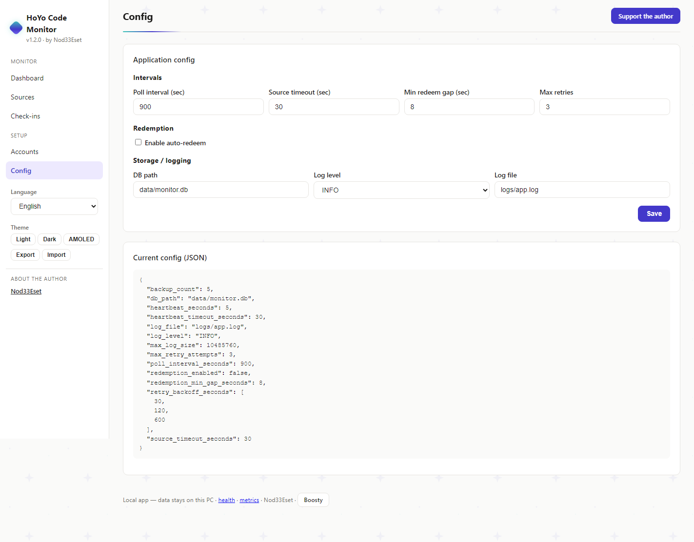

# HoYo Code Monitor

[](https://github.com/retvil/hoyo-code-monitor/releases) [](../LICENSE) [](https://github.com/retvil/hoyo-code-monitor/releases)

[🇬🇧 English](../README.md) | [🇷🇺 Русский](README.ru.md) | [🇺🇦 Українська](README.uk.md) | [🇰🇿 Қазақша](README.kk.md) | [🇩🇪 Deutsch](README.de.md) | [🇫🇷 Français](README.fr.md) | **🇪🇸 Español** | [🇯🇵 日本語](README.ja.md) | [🇵🇱 Polski](README.pl.md) | [🇹🇷 Türkçe](README.tr.md) | [🇨🇳 中文](README.zh.md) | [🇹🇼 繁體中文](README.zh-TW.md)

## ¿Qué es esto?

Los juegos de HoYoverse lanzan regularmente códigos promocionales por tiempo limitado — y caducan rápido. **HoYo Code Monitor** vigila 23 fuentes de códigos en 5 juegos (Genshin Impact, Honkai: Star Rail, Zenless Zone Zero, Honkai Impact 3rd, Tears of Themis) y canjea automáticamente los códigos nuevos en tus cuentas. Todo se ejecuta localmente en tu PC: base de datos SQLite, cookies cifradas, sin telemetría, sin nube.

### Cómo funciona

1. El programador consulta las fuentes habilitadas, extrae códigos (`[A-Z0-9]{8,14}`) y guarda los nuevos.
2. Para cada cuenta con canje automático activado: `GET webExchangeCdkey` con las cookies de la cuenta, con una pausa configurable entre canjes (8 s por defecto).
3. Resultado registrado: `success` → Done + recompensa; `-2017/-2018` → ya canjeado (cuenta como Done); `-2001` caducado, `-2003` inválido/solo China.
4. Los check-ins diarios de HoYoLAB siguen su propio horario (04:00 + variación por defecto): `info → sign → home` por cuenta × juego, con las mismas cookies, resultados en la página Check-ins.
5. Si un check-in falla porque las cookies caducaron, el programador puede **renovarlas automáticamente en modo headless** desde el perfil de navegador guardado (opción opt-in, cooldown por cuenta) — sin necesidad de volver a iniciar sesión manualmente mientras la sesión guardada siga siendo válida.

## Características

- **Monitorización en segundo plano** — comprueba fuentes cada N minutos (configurable, 15 por defecto)
- **Canje automático** — canjea códigos nuevos vía API `webExchangeCdkey` de Hoyolab (opt-in, por cuenta)
- **Check-ins diarios** — inicio de sesión automático en HoYoLAB para los 5 juegos (opt-in, por cuenta, horario propio, idempotente)
- **Multi-fuente** — Wiki, API Wiki, APIs JSON de la comunidad, sitios de guías (23 presets)
- **Multi-cuenta** — cada cuenta tiene sus propias cookies cifradas y su propio interruptor de canje
- **Renovación automática de cookies** — cuando un check-in falla por cookies caducadas, se recapturan en modo headless desde el perfil de navegador guardado
- **Filtrar por juego** — el programador omite los juegos que la cuenta no tiene habilitados
- **Estado «activo» por fuente** — las fuentes verificadas con éxito se muestran como «activas»
- **Estadísticas** — total / canjeados / fallidos, desglose por fuente, registro de canjes
- **Web UI** — panel local en `http://127.0.0.1:8000`, disponible en 6 idiomas
- **Bandeja del sistema** — icono con activar/desactivar, submenú de intervalo de escaneo, ajustes con un clic
- **Cookies cifradas** — Fernet (AES-128), clave en env / almacén del sistema / archivo local
- **Tema oscuro** — interruptor Claro/Oscuro en la barra lateral; la elección persiste por navegador
- **Autoarranque** — inicio al entrar en Windows (activado por defecto)

## Capturas de pantalla

<details>
<summary>Panel / Fuentes / Configuración / Check-ins / Cuentas / Autor</summary>

| Panel | Fuentes | Configuración |
|---|---|---|
|  |  |  |

| Autor |
|---|
|  |

| Check-ins | Cuentas |
|---|---|
|  |  |

</details>

## Fuentes (verificadas en vivo)

| Fuente | Tipo | Estado |
|---|---|---|
| Genshin Wiki (Fandom) | CSS | May return 403 (Fandom protection) |
| Genshin Wiki API | JSON | Working |
| `hoyo-codes.seria.moe` | JSON API | Working |
| `api.ennead.cc` (x2 endpoints) | JSON API | Working |
| Pocket Tactics, TheClick, Eurogamer, MMO Culture, Playnforge | CSS guides | Working |

## Instalar desde el instalador

Descarga la última versión desde [GitHub Releases](https://github.com/retvil/hoyo-code-monitor/releases):

| Archivo | Descripción |
|---|---|
| `hoyo-code-monitor-X.Y.Z-setup.exe` | Instalador Inno Setup (por usuario, sin necesidad de derechos de administrador) |

### Instalación interactiva

1. Ejecuta el `.exe` — te preguntará dónde instalar
2. Pulsa **Siguiente** — dos componentes incluidos: acceso directo en el escritorio e inicio automático de Windows
3. Pulsa **Instalar** — listo en ~30 s. La app arranca en la bandeja del sistema.

### Instalación silenciosa (scripts / GPO / SCCM)

```powershell
# Per-user install, no prompts
hoyo-code-monitor-1.5.3-setup.exe /S

# Install to a specific directory
hoyo-code-monitor-1.5.3-setup.exe /S /D=C:\Games\HoYoMonitor

# No desktop shortcut, no autostart
hoyo-code-monitor-1.5.3-setup.exe /S /desktop=no /startup=no
```

### Desinstalación

- **Panel de control** → Programas y características → "HoYo Code Monitor" → Desinstalar
- **Silenciosa**: `uninstall.exe /S`
- O elimina la carpeta de instalación y la clave de registro `HKCU\Software\HoYoCodeMonitor`

### Ubicaciones de datos (persisten entre desinstalaciones/reinstalaciones)

| Qué | Dónde |
|---|---|
| SQLite database | `%LOCALAPPDATA%\HoYoCodeMonitor\monitor.db` |
| `config.toml` (settings, source definitions) | `%LOCALAPPDATA%\HoYoCodeMonitor\config.toml` |
| Encrypted Fernet key | OS keyring (Windows Credential Manager) |
| Logs | `%LOCALAPPDATA%\HoYoCodeMonitor\logs\` |
| Browser profile (Playwright Chromium) | `%LOCALAPPDATA%\HoYoCodeMonitor\browser-profile\` |

> Haz una copia de seguridad de `data/` + `config.toml` antes de una actualización mayor.

## Inicio rápido

```powershell
# 1. Install and launch - the app lives in the system tray
# 2. Add an account (region: os_usa / os_euro / os_asia / os_cht)
hoyo-code-monitor accounts add main <UID> <REGION>

# 3. Capture cookies once (browser opens, you log in once)
hoyo-code-monitor accounts login main

# 4. Enable auto-redeem (or toggle per account in the Web UI)
hoyo-code-monitor config set redemption_enabled true
```

5. Open the dashboard: `http://127.0.0.1:8000`

## Instalar desde el código fuente

Requiere Python 3.11+ ([python.org](https://python.org)).

```powershell
pip install -e .
# Playwright browser for JS-rendered sources (optional)
python -m playwright install chromium
```

Ejecutar en bandeja (recomendado) / comprobación única / Web UI:

```powershell
hoyo-code-monitor tray
hoyo-code-monitor run-once
python -m uvicorn src.web_ui:app --host 127.0.0.1 --port 8000
```

## Preguntas frecuentes

- **¿El código se queda en Pending?** Comprueba las cookies (caducan), `redemption_enabled`, el interruptor de la cuenta y el error en el registro de canjes.
- **¿`-1071 "Please log in"`?** Vuelve a ejecutar `accounts login` — el conjunto de cookies estaba incompleto.
- **¿Dónde están los datos?** `data/monitor.db`, `config.toml`, `logs/`, `data/.key`. Copia `data/` para hacer copia de seguridad.

## Autor y soporte

Consulta el bloque «Acerca del autor» en el panel de la app, o abajo:

**Criptomonedas:**

- BTC: `bc1qunld3rsp37qf5gg69aune50y0qqkd0eugg7j97`
- TON: `UQDmvr4SKOxSION3Yky6aOgzAnCDXySPuAbG4EKJa5JUT7tC`
- USDT (TRC20): `TBPJSSLu1mUcX54g9UyxUohYGf2fuRvbwd`
- USDT (ERC20): `0x25CAED3776Ef5b18E03392bC5b254Bbd78E8180C`
- USDT (SOL): `3qgN5z291CEcj2FUi2Zza5DioxKgNw72kC7P52pCcTrG`

## Licencia

MIT
