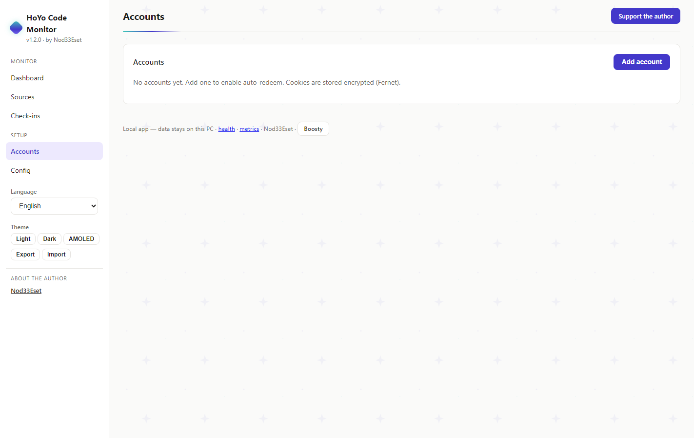

# HoYo Code Monitor

[](https://github.com/retvil/hoyo-code-monitor/releases) [](../LICENSE) [](https://github.com/retvil/hoyo-code-monitor/releases)

[🇬🇧 English](../README.md) | [🇷🇺 Русский](README.ru.md) | [🇺🇦 Українська](README.uk.md) | **🇰🇿 Қазақша** | [🇩🇪 Deutsch](README.de.md) | [🇫🇷 Français](README.fr.md) | [🇪🇸 Español](README.es.md) | [🇯🇵 日本語](README.ja.md) | [🇵🇱 Polski](README.pl.md) | [🇹🇷 Türkçe](README.tr.md) | [🇨🇳 中文](README.zh.md) | [🇹🇼 繁體中文](README.zh-TW.md)

## Бұл не?

HoYoverse ойындары мерзімі шектеулі промокодтарды жүйелі түрде шығарады — олар тез жарамсыз болады. **HoYo Code Monitor** 5 ойындағы 23 код көзін (Genshin Impact, Honkai: Star Rail, Zenless Zone Zero, Honkai Impact 3rd, Tears of Themis) бақылап, жаңа кодтарды аккаунттарыңызға автоматты түрде белсендіреді. Барлығы компьютеріңізде жергілікті жұмыс істейді: SQLite дерекқоры, шифрланған cookie файлдары, телеметрия жоқ, бұлт жоқ.

### Бұл қалай жұмыс істейді

1. Жоспарлаушы қосылған көздерді сұрап, кодтарды шығарады (`[A-Z0-9]{8,14}`), жаңаларын сақтайды.
2. Автобелсендіру қосылған әр аккаунт үшін: `GET webExchangeCdkey` аккаунт cookie файлдарымен, белсендірулер арасындағы реттелетін үзіліс (әдепкі 8 с).
3. Нәтиже жазылады: `success` → Done + сыйақы; `-2017/-2018` → бұрын белсендірілген (Done деп есептеледі); `-2001` мерзімі өткен, `-2003` жарамсыз/тек Қытай.
4. Күнделікті HoYoLAB белгілері өз кестесімен жүреді (әдепкі 04:00 + ауытқу): `info → sign → home` әр аккаунт × ойын үшін, сол cookie файлдарымен, нәтижелер «Белгілер» бетінде.
5. Егер белгі мерзімі өткен cookie файлдарына байланысты сәтсіз болса, жоспарлаушы оларды сақталған браузер профилінен **headless режимінде автоматты түрде жаңарта алады** (опционалды қосқыш, әр аккаунт үшін кулдаун) — сақталған сессия жарамды болғанша қолмен қайта кіру қажет емес.

## Мүмкіндіктер

- **Фондық мониторинг** — көздерді әр N минут сайын тексеру (реттеледі, әдепкі 15)
- **Автобелсендіру** — жаңа кодтарды Hoyolab `webExchangeCdkey` API арқылы белсендіру (опционалды, әр аккаунт үшін жеке)
- **Күнделікті белгілер** — барлық 5 ойын үшін HoYoLAB-та автоматты белгілеу (опционалды, әр аккаунт үшін жеке, өз кестесі, идемпотентті)
- **Көп көзді** — Wiki, Wiki API, қауымдастық JSON API, нұсқаулық сайттары (23 пресет)
- **Көп аккаунтты** — әр аккаунттың өз шифрланған cookie файлдары мен өз белсендіру қосқышы бар
- **Cookie файлдарын автожаңарту** — белгі мерзімі өткен cookie файлдарына байланысты сәтсіз болса, олар headless режимінде автоматты түрде қайта ұсталады
- **Көздер бойынша «белсенді» мәртебесі** — сәтті тексерілген көздер «белсенді» деп көрсетіледі
- **Статистика** — барлығы / белсендірілген / сәтсіз, көздер бойынша бөліну, белсендіру журналы
- **Web UI** — `http://127.0.0.1:8000` мекенжайындағы жергілікті дашборд, 6 тілде
- **Жүйелік трей** — қосу/өшіру, сканерлеу аралығының ішкі мәзірі, параметрлерді бір басумен ашу
- **Cookie шифрлау** — Fernet (AES-128), кілт env / ЖЖҚ қоймасында / жергілікті файлда
- **Қараңғы тақырып** — бүйір панеліндегі Light/Dark қосқышы; таңдау браузерде сақталады
- **Автозапуск** — Windows-қа кіргенде іске қосылады (әдепкі бойынша қосулы)

## Скриншоттар

<details>
<summary>Дашборд / Көздер / Параметрлер / Белгілер / Аккаунттар / Автор туралы</summary>

| Дашборд | Көздер | Параметрлер |
|---|---|---|
|  |  |  |

| Автор туралы |
|---|
|  |

| Белгілер | Аккаунттар |
|---|---|
|  |  |

</details>

## Көздер (нақты тексерілген)

| Көз | Түрі | Мәртебесі |
|---|---|---|
| Genshin Wiki (Fandom) | CSS | May return 403 (Fandom protection) |
| Genshin Wiki API | JSON | Working |
| `hoyo-codes.seria.moe` | JSON API | Working |
| `api.ennead.cc` (x2 endpoints) | JSON API | Working |
| Pocket Tactics, TheClick, Eurogamer, MMO Culture, Playnforge | CSS guides | Working |

## Инсталлятордан орнату

Соңғы релизді [GitHub Releases](https://github.com/retvil/hoyo-code-monitor/releases) жерінен жүктеңіз:

| Файл | Сипаттама |
|---|---|
| `hoyo-code-monitor-X.Y.Z-setup.exe` | Inno Setup инсталляторы (ағымдағы пайдаланушы үшін, әкімші құқықтары қажет емес) |

### Интерактивті орнату

1. `.exe` файлын іске қосыңыз — орнату орны сұралады
2. **Келесі** түймесін басыңыз — екі компонент қолжетімді: жұмыс үстеліндегі таңбаша және Windows автозапускісі
3. **Орнату** түймесін басыңыз — ~30 секундта дайын. Қолданба жүйелік трейде автоматты түрде іске қосылады.

### Тыныш орнату (скрипттер / GPO / SCCM)

```powershell
# Per-user install, no prompts
hoyo-code-monitor-1.5.3-setup.exe /S

# Install to a specific directory
hoyo-code-monitor-1.5.3-setup.exe /S /D=C:\Games\HoYoMonitor

# No desktop shortcut, no autostart
hoyo-code-monitor-1.5.3-setup.exe /S /desktop=no /startup=no
```

### Жою

- **Басқару тақтасы** → Бағдарламалар мен компоненттер → "HoYo Code Monitor" → Жою
- **Тыныш**: `uninstall.exe /S`
- Немесе орнату қалтасын және `HKCU\Software\HoYoCodeMonitor` тіркеу кілтін жойыңыз

### Деректер орны (жою/қайта орнату арасында сақталады)

| Не | Қайда |
|---|---|
| SQLite database | `%LOCALAPPDATA%\HoYoCodeMonitor\monitor.db` |
| `config.toml` (settings, source definitions) | `%LOCALAPPDATA%\HoYoCodeMonitor\config.toml` |
| Encrypted Fernet key | OS keyring (Windows Credential Manager) |
| Logs | `%LOCALAPPDATA%\HoYoCodeMonitor\logs\` |
| Browser profile (Playwright Chromium) | `%LOCALAPPDATA%\HoYoCodeMonitor\browser-profile\` |

> Мажорлық жаңарту алдында `data/` + `config.toml` резервтік көшірмесін жасаңыз.

## Жылдам бастау

```powershell
# 1. Install and launch - the app lives in the system tray
# 2. Add an account (region: os_usa / os_euro / os_asia / os_cht)
hoyo-code-monitor accounts add main <UID> <REGION>

# 3. Capture cookies once (browser opens, you log in once)
hoyo-code-monitor accounts login main

# 4. Enable auto-redeem (or toggle per account in the Web UI)
hoyo-code-monitor config set redemption_enabled true
```

5. Open the dashboard: `http://127.0.0.1:8000`

## Бастапқы кодтан орнату

Python 3.11+ қажет ([python.org](https://python.org)).

```powershell
pip install -e .
# Playwright browser for JS-rendered sources (optional)
python -m playwright install chromium
```

Трейде іске қосу (ұсынылады) / бір реттік тексеру / Web UI:

```powershell
hoyo-code-monitor tray
hoyo-code-monitor run-once
python -m uvicorn src.web_ui:app --host 127.0.0.1 --port 8000
```

## Жиі қойылатын сұрақтар

- **Код Pending күйінде тұр ма?** Cookie файлдарын (мерзімі өтеді), `redemption_enabled`, аккаунт қосқышын және белсендіру журналындағы қатені тексеріңіз.
- **`-1071 "Please log in"`?** `accounts login` қайталаңыз — cookie жиынтығы толық емес.
- **Деректер қайда?** `data/monitor.db`, `config.toml`, `logs/`, `data/.key`. Сақтық көшірме үшін `data/` көшіріңіз.

## Автор және қолдау

Қолданба дашбордындағы «Автор туралы» блогын немесе төмендегі ақпаратты қараңыз:

**Криптовалюта:**

- BTC: `bc1qunld3rsp37qf5gg69aune50y0qqkd0eugg7j97`
- TON: `UQDmvr4SKOxSION3Yky6aOgzAnCDXySPuAbG4EKJa5JUT7tC`
- USDT (TRC20): `TBPJSSLu1mUcX54g9UyxUohYGf2fuRvbwd`
- USDT (ERC20): `0x25CAED3776Ef5b18E03392bC5b254Bbd78E8180C`
- USDT (SOL): `3qgN5z291CEcj2FUi2Zza5DioxKgNw72kC7P52pCcTrG`

## Лицензия

MIT
