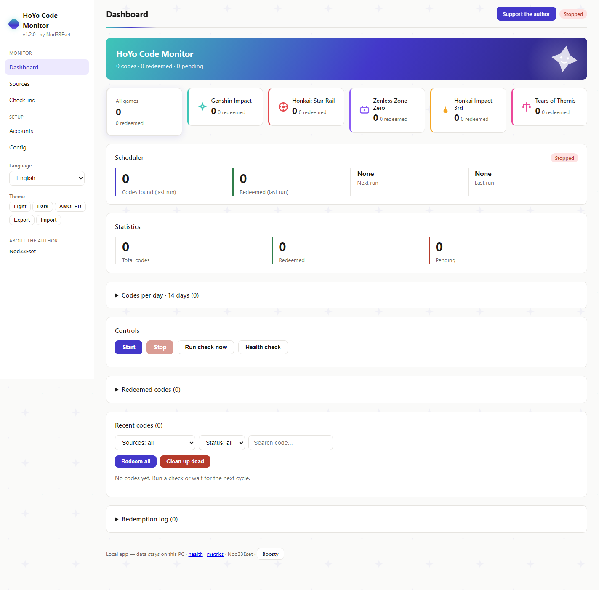
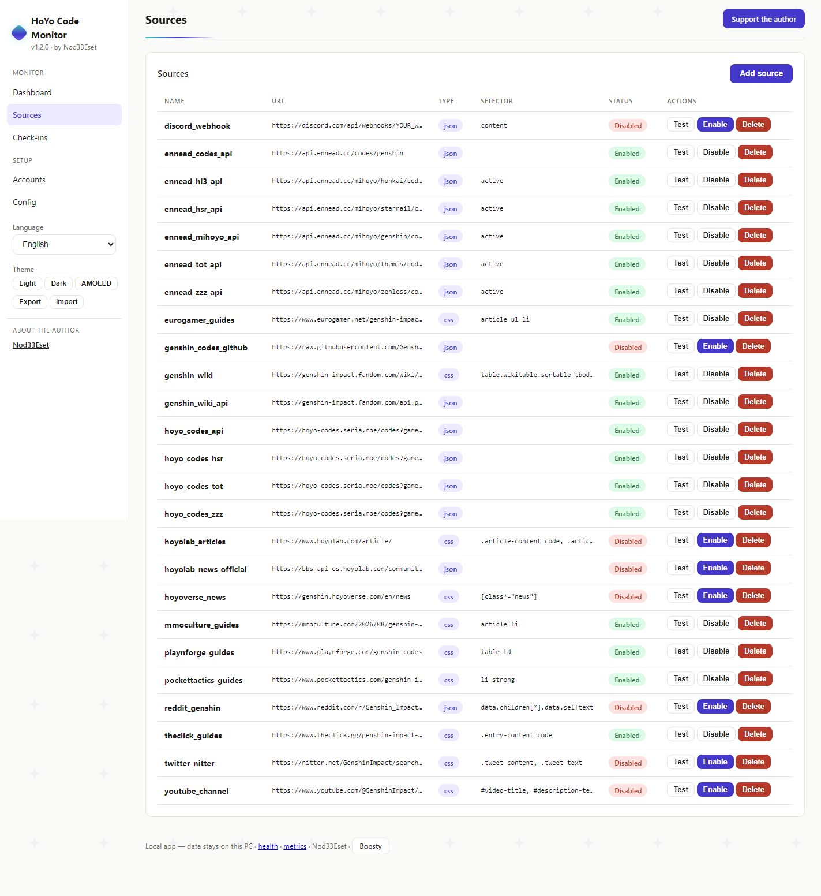
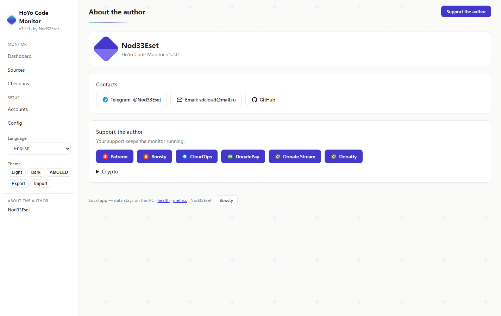

# HoYo Code Monitor

[](https://github.com/retvil/hoyo-code-monitor/releases) [](../LICENSE) [](https://github.com/retvil/hoyo-code-monitor/releases)

[🇬🇧 English](../README.md) | [🇷🇺 Русский](README.ru.md) | [🇺🇦 Українська](README.uk.md) | [🇰🇿 Қазақша](README.kk.md) | [🇩🇪 Deutsch](README.de.md) | [🇫🇷 Français](README.fr.md) | [🇪🇸 Español](README.es.md) | [🇯🇵 日本語](README.ja.md) | **🇵🇱 Polski** | [🇹🇷 Türkçe](README.tr.md) | [🇨🇳 中文](README.zh.md) | [🇹🇼 繁體中文](README.zh-TW.md)

## Co to jest?

Gry HoYoverse regularnie wydają kody promocyjne o ograniczonym czasie ważności — i szybko wygasają. **HoYo Code Monitor** obserwuje 23 źródła kodów w 5 grach (Genshin Impact, Honkai: Star Rail, Zenless Zone Zero, Honkai Impact 3rd, Tears of Themis) i automatycznie realizuje nowe kody na Twoich kontach. Wszystko działa lokalnie na Twoim komputerze: baza SQLite, zaszyfrowane cookies, brak telemetrii, brak chmury.

### Jak to działa

1. Harmonogram odpytuje włączone źródła, wyodrębnia kody (`[A-Z0-9]{8,14}`) i zapisuje nowe.
2. Dla każdego konta z włączonym automatycznym realizowaniem: `GET webExchangeCdkey` z cookies konta, konfigurowalna przerwa między realizacjami (domyślnie 8 s).
3. Wynik zapisywany: `success` → Done + nagroda; `-2017/-2018` → już zrealizowane (liczone jako Done); `-2001` wygasłe, `-2003` nieprawidłowe/tylko Chiny.
4. Codzienne zameldowania HoYoLAB działają według własnego harmonogramu (domyślnie 04:00 + losowe rozłożenie): `info → sign → home` na konto × grę, tymi samymi cookies, wyniki na stronie Zameldowania.
5. Jeśli zameldowanie nie powiedzie się z powodu wygasłych cookies, harmonogram może **automatycznie odświeżyć je w trybie headless** z zapisanego profilu przeglądarki (opcjonalny przełącznik, cooldown na konto) — bez ręcznego ponownego logowania, dopóki zapisana sesja jest ważna.

## Funkcje

- **Monitorowanie w tle** — sprawdzanie źródeł co N minut (konfigurowalne, domyślnie 15)
- **Automatyczne realizowanie** — realizacja nowych kodów przez API Hoyolab `webExchangeCdkey` (opcjonalne, per konto)
- **Codzienne zameldowania** — automatyczne logowanie HoYoLAB dla wszystkich 5 gier (opcjonalne, per konto, własny harmonogram, idempotentne)
- **Wiele źródeł** — Wiki, API Wiki, API JSON społeczności, strony z poradnikami (23 presety)
- **Wiele kont** — każde konto ma własne zaszyfrowane cookies i własny przełącznik realizacji
- **Automatyczne odświeżanie cookies** — gdy zameldowanie zawiedzie z powodu wygasłych cookies, są one przechwytywane ponownie w trybie headless
- **Filtr włączonych gier** — harmonogram pomija gry, których konto nie ma włączonych
- **Status „aktywne” per źródło** — źródła pomyślnie zweryfikowane są wyświetlane jako „aktywne”
- **Statystyki** — łącznie / zrealizowane / nieudane, podział per źródło, dziennik realizacji
- **Web UI** — lokalny panel pod `http://127.0.0.1:8000`, dostępny w 6 językach
- **Zasobnik systemowy** — ikona z włącz/wyłącz, podmenu interwału skanowania, ustawienia jednym kliknięciem
- **Szyfrowanie cookies** — Fernet (AES-128), klucz w env / magazynie systemowym / pliku lokalnym
- **Motyw ciemny** — przełącznik Jasny/Ciemny na pasku bocznym; wybór zapisywany per przeglądarka
- **Autostart** — uruchamianie przy logowaniu do Windows (domyślnie włączone)

## Zrzuty ekranu

<details>
<summary>Panel / Źródła / Konfiguracja / Zameldowania / Konta / Autor</summary>

| Panel | Źródła | Konfiguracja |
|---|---|---|
|  |  |  |

| Autor |
|---|
|  |

| Zameldowania | Konta |
|---|---|
|  |  |

</details>

## Źródła (zweryfikowane na żywo)

| Źródło | Typ | Status |
|---|---|---|
| Genshin Wiki (Fandom) | CSS | May return 403 (Fandom protection) |
| Genshin Wiki API | JSON | Working |
| `hoyo-codes.seria.moe` | JSON API | Working |
| `api.ennead.cc` (x2 endpoints) | JSON API | Working |
| Pocket Tactics, TheClick, Eurogamer, MMO Culture, Playnforge | CSS guides | Working |

## Instalacja z instalatora

Pobierz najnowsze wydanie z [GitHub Releases](https://github.com/retvil/hoyo-code-monitor/releases):

| Plik | Opis |
|---|---|
| `hoyo-code-monitor-X.Y.Z-setup.exe` | Instalator Inno Setup (dla bieżącego użytkownika, bez uprawnień administratora) |

### Instalacja interaktywna

1. Uruchom `.exe` — zapyta o lokalizację instalacji
2. Kliknij **Dalej** — dwa komponenty: skrót na pulpicie i autostart Windows
3. Kliknij **Zainstaluj** — gotowe w ~30 s. Aplikacja uruchamia się w zasobniku systemowym.

### Instalacja cicha (skrypty / GPO / SCCM)

```powershell
# Per-user install, no prompts
hoyo-code-monitor-1.5.3-setup.exe /S

# Install to a specific directory
hoyo-code-monitor-1.5.3-setup.exe /S /D=C:\Games\HoYoMonitor

# No desktop shortcut, no autostart
hoyo-code-monitor-1.5.3-setup.exe /S /desktop=no /startup=no
```

### Odinstalowanie

- **Panel sterowania** → Programy i funkcje → "HoYo Code Monitor" → Odinstaluj
- **Cicho**: `uninstall.exe /S`
- Lub usuń folder instalacji i klucz rejestru `HKCU\Software\HoYoCodeMonitor`

### Lokalizacje danych (zachowywane między odinstalowaniem/ponowną instalacją)

| Co | Gdzie |
|---|---|
| SQLite database | `%LOCALAPPDATA%\HoYoCodeMonitor\monitor.db` |
| `config.toml` (settings, source definitions) | `%LOCALAPPDATA%\HoYoCodeMonitor\config.toml` |
| Encrypted Fernet key | OS keyring (Windows Credential Manager) |
| Logs | `%LOCALAPPDATA%\HoYoCodeMonitor\logs\` |
| Browser profile (Playwright Chromium) | `%LOCALAPPDATA%\HoYoCodeMonitor\browser-profile\` |

> Przed aktualizacją major zrób kopię zapasową `data/` + `config.toml`.

## Szybki start

```powershell
# 1. Install and launch - the app lives in the system tray
# 2. Add an account (region: os_usa / os_euro / os_asia / os_cht)
hoyo-code-monitor accounts add main <UID> <REGION>

# 3. Capture cookies once (browser opens, you log in once)
hoyo-code-monitor accounts login main

# 4. Enable auto-redeem (or toggle per account in the Web UI)
hoyo-code-monitor config set redemption_enabled true
```

5. Open the dashboard: `http://127.0.0.1:8000`

## Instalacja ze źródeł

Wymaga Python 3.11+ ([python.org](https://python.org)).

```powershell
pip install -e .
# Playwright browser for JS-rendered sources (optional)
python -m playwright install chromium
```

Uruchom w zasobniku (zalecane) / jednorazowe sprawdzenie / Web UI:

```powershell
hoyo-code-monitor tray
hoyo-code-monitor run-once
python -m uvicorn src.web_ui:app --host 127.0.0.1 --port 8000
```

## FAQ

- **Kod wisi jako Pending?** Sprawdź cookies (wygasają), `redemption_enabled`, przełącznik konta i błąd w dzienniku realizacji.
- **`-1071 "Please log in"`?** Ponów `accounts login` — zestaw cookies był niekompletny.
- **Gdzie są dane?** `data/monitor.db`, `config.toml`, `logs/`, `data/.key`. Skopiuj `data/` na backup.

## Autor i wsparcie

Zobacz blok „O autorze” na panelu aplikacji lub poniżej:

**Kryptowaluty:**

- BTC: `bc1qunld3rsp37qf5gg69aune50y0qqkd0eugg7j97`
- TON: `UQDmvr4SKOxSION3Yky6aOgzAnCDXySPuAbG4EKJa5JUT7tC`
- USDT (TRC20): `TBPJSSLu1mUcX54g9UyxUohYGf2fuRvbwd`
- USDT (ERC20): `0x25CAED3776Ef5b18E03392bC5b254Bbd78E8180C`
- USDT (SOL): `3qgN5z291CEcj2FUi2Zza5DioxKgNw72kC7P52pCcTrG`

## Licencja

MIT
