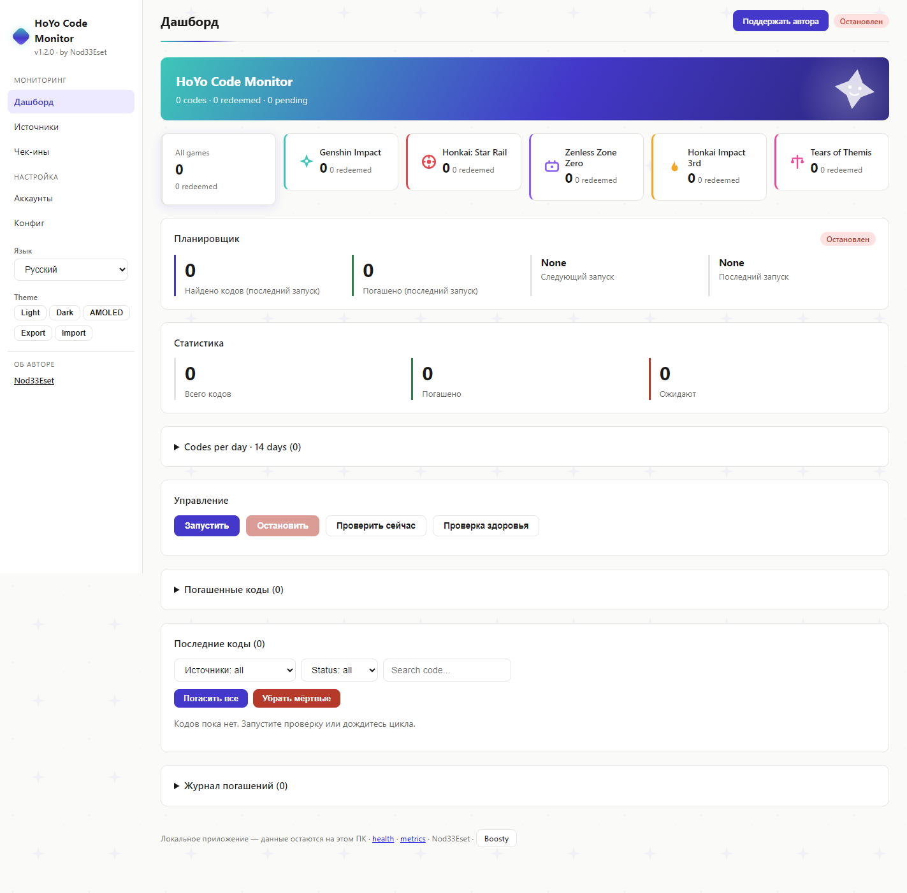
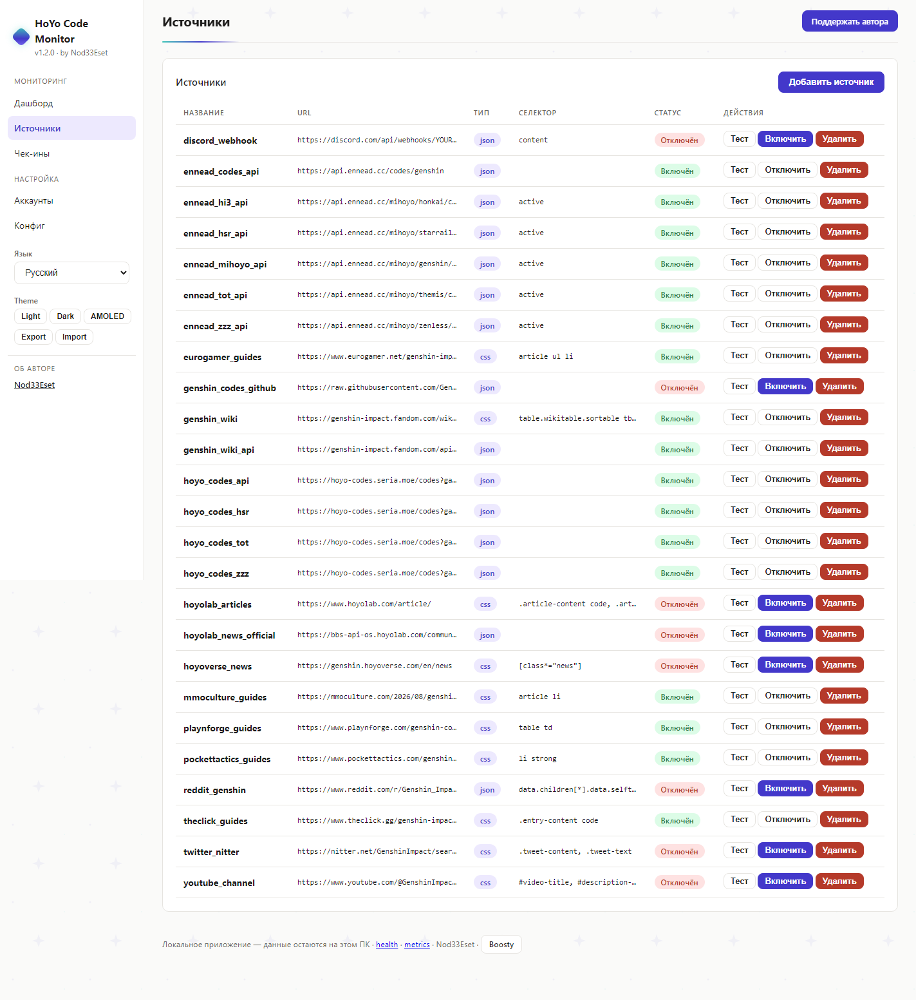
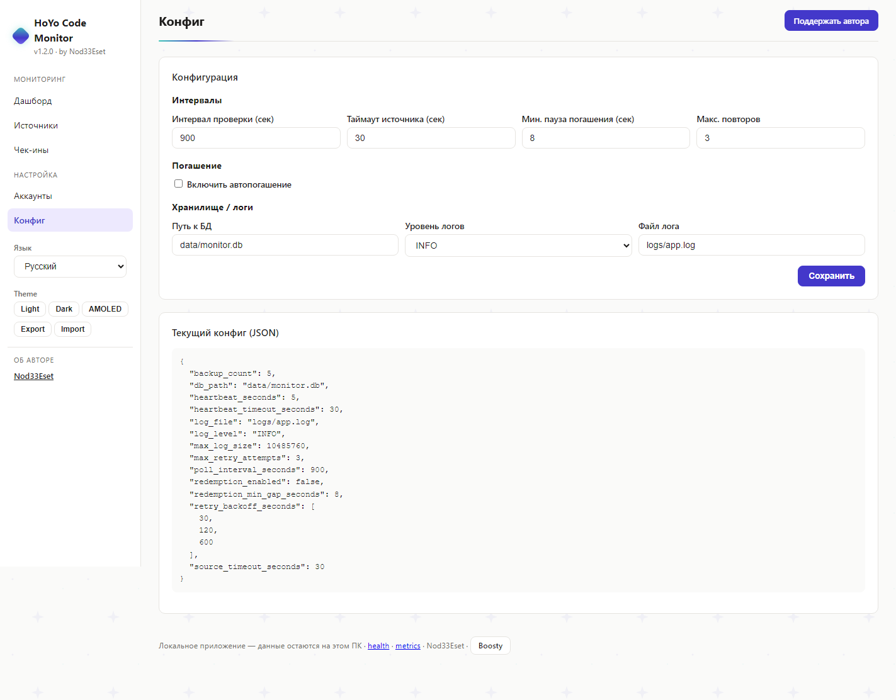
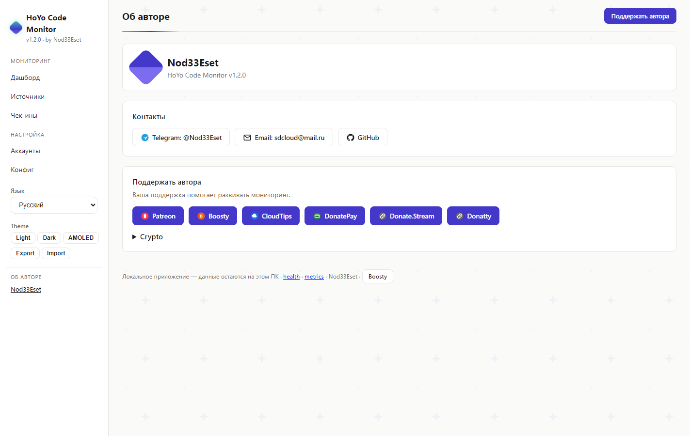
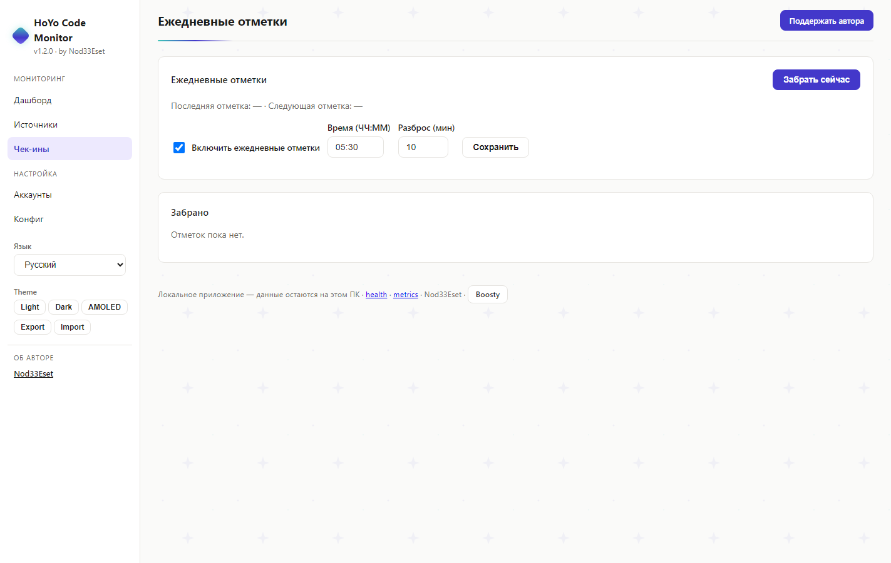
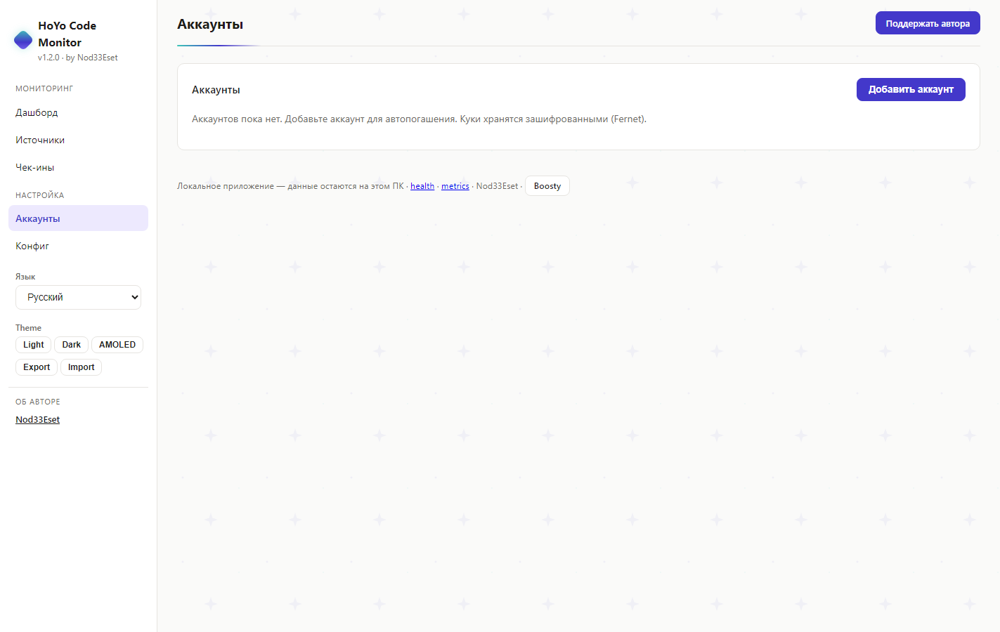

# HoYo Code Monitor

[](https://github.com/retvil/hoyo-code-monitor/releases) [](../LICENSE) [](https://github.com/retvil/hoyo-code-monitor/releases)

**Никогда больше не пропускайте промокоды HoYoverse — локальный мониторинг и автопогашение для 5 игр прямо на вашем ПК.**

[🇬🇧 English](../README.md) | **🇷🇺 Русский** | [🇺🇦 Українська](README.uk.md) | [🇰🇿 Қазақша](README.kk.md) | [🇩🇪 Deutsch](README.de.md) | [🇫🇷 Français](README.fr.md) | [🇪🇸 Español](README.es.md) | [🇯🇵 日本語](README.ja.md) | [🇵🇱 Polski](README.pl.md) | [🇹🇷 Türkçe](README.tr.md) | [🇨🇳 中文](README.zh.md) | [🇹🇼 繁體中文](README.zh-TW.md)

## Что это?

Игры HoYoverse регулярно выпускают промокоды с ограниченным сроком действия — и они быстро протухают. **HoYo Code Monitor** следит за 16 источниками кодов в 5 играх (Genshin Impact, Honkai: Star Rail, Zenless Zone Zero, Honkai Impact 3rd, Tears of Themis) и автоматически погашает новые коды на ваших аккаунтах. Всё работает локально на вашем ПК: SQLite-база, зашифрованные куки, никакой телеметрии и облаков.

### Как это работает

1. Планировщик опрашивает включённые источники, извлекает коды (`[A-Z0-9]{8,14}`), сохраняет новые.
2. Для каждого аккаунта с включённым автопогашением: `GET webExchangeCdkey` с куками аккаунта, настраиваемая пауза между погашениями (по умолчанию 8с).
3. Результат записывается: `success` → Done + награда; `-2017/-2018` → уже погашен (считается Done); `-2001` протух, `-2003` невалиден/только Китай.
4. Ежедневные отметки HoYoLAB идут по своему расписанию (по умолчанию 04:00 + разброс): `info → sign → home` на аккаунт × игру, теми же куками, результат — на странице «Чек-ины».
5. Если отметка упала из-за просроченных кук, планировщик может **автоматически обновить их в headless-режиме** из сохранённого браузерного профиля (опциональный тумблер, пер-аккаунт кулдаун) — без ручного повторного входа, пока сохранённая сессия валидна.

## Усиление безопасности (v1.6.0)

Аудит v1.6.0 исправил 45 проблем разного уровня критичности. Основные изменения:

| Область | Что изменилось |
|---|---|
| **SSRF** | URL источников, резолвящиеся в приватные диапазоны (10.x, 172.16–31.x, 192.168.x, 127.x, 169.254.x, 0.0.0.0) или использующие не-HTTP схемы, отклоняются при создании/обновлении |
| **ReDoS** | Шаблоны regex-экстрактора с вложенными квантификаторами (`(a+)+`, `(.*a)*`) отклоняются |
| **XSS** | Имена источников, значения кук и строки ошибок, выводимые в HTML-эндпоинтах, экранируются перед вставкой |
| **CSRF** | Сид токена сохраняется в файл с датой; устаревший сид (от другого дня) ротирован при старте |
| **Валидация игры** | `POST /import` отклоняет payload'ы с неизвестным полем `game` |
| **Таймаут на источник** | Полевой `timeout_seconds` теперь передаётся в aiohttp (ранее игнорировался) |
| **Пустая награда** | При отсутствии данных в ответе API хранится `reward=""` вместо литерала `"Redeemed"` |
| **Производительность** | Путь получения статистики сокращён с 20 SQL-запросов до 1 `GROUP BY`; список погашенных кодов теперь сортируется в SQL |

Все 45 исправлений покрыты 30 новыми регрессионными тестами.

## Возможности

- **Фоновый мониторинг** — проверка источников каждые N минут (настраивается, по умолчанию 15)
- **Автопогашение** — погашение новых кодов через Hoyolab `webExchangeCdkey` API (опционально, отдельно для каждого аккаунта)
- **Ежедневные отметки** — авто-чек-ин в HoYoLAB для всех 5 игр: Genshin, Star Rail, ZZZ, HI3, Tears of Themis (опционально, отдельно для каждого аккаунта, своё расписание, идемпотентно)
- **Мульти-источники** — Wiki, Wiki API, community JSON API, гайд-сайты (16 пресетов, см. таблицу)
- **Мульти-аккаунт** — у каждого аккаунта свои зашифрованные куки и свой тумблер погашения
- **Фильтр включённых игр** — в аккаунте можно отметить, в каких именно играх делать отметки (`accounts.games`, миграция v15); планировщик пропускает игры, которые аккаунт не включил — нет лишнего «-10002 no-character» в логе
- **Автообновление кук** — при падении отметки из-за просроченных кук они автоматически захватываются заново в headless-режиме из сохранённого браузерного профиля (опционально, пер-аккаунт кулдаун) — мониторинг не обрывается без ручного повторного входа
- **Статус «активен» по источникам** — источники, успешно проверенные, отображаются как «активны»; при неудаче статус сбрасывается на «неактивен» (колонка `last_success`, миграция v16)
- **Отключить проверку обновлений** — ключ `update_check_enabled = false` в config полностью отключает запрос к GitHub, баннер не показывается
- **Статистика** — всего / погашено / провалено, разбивка по источникам, журнал погашений
- **Web UI** — локальный дашборд `http://127.0.0.1:8000` на 6 языках
- **Системный трей** — иконка с вкл/выкл, подменю периода сканирования, открытие настроек в один клик
- **Шифрование куков** — Fernet (AES-128), ключ в env / системном хранилище / локальном файле
- **Тёмная тема** — переключатель Light/Dark в сайдбаре; выбор запоминается в браузере
- **Автозапуск** — старт при входе в Windows (включён по умолчанию)

## Скриншоты

<details>
<summary>Дашборд / Источники / Настройки / Чек-ины / Аккаунты / Об авторе</summary>

| Дашборд | Источники | Настройки |
|---|---|---|
|  |  |  |

| Об авторе |
|---|
|  |

| Чек-ины | Аккаунты |
|---|---|
|  |  |

</details>

## Источники (проверены живьём)

| Источник | Тип | Статус |
|---|---|---|
| Genshin Wiki (Fandom) | CSS | Может отдавать 403 (защита Fandom) |
| Genshin Wiki API | JSON | Работает |
| `hoyo-codes.seria.moe` | JSON API | Работает |
| `api.ennead.cc` (2 эндпоинта) | JSON API | Работает |
| Pocket Tactics, TheClick, Eurogamer, MMO Culture, Playnforge | CSS-гайды | Работают |

## Готовые сборки

Скачайте установщик из [Releases](https://github.com/retvil/hoyo-code-monitor/releases):

- **Windows** — `hoyo-code-monitor-1.5.2-setup.exe` (установка для текущего пользователя, права администратора не нужны)

Тихая установка: `setup.exe /S`. Компоненты: ярлык на рабочем столе, автозагрузка Windows (оба включены по умолчанию).

> **Примечание:** При первом входе через браузер приложение скачает Chromium (~170 МБ, один раз).

## Быстрый старт

```powershell
# 1. Установите и запустите — приложение живёт в системном трее
# 2. Добавьте аккаунт (регион: os_usa / os_euro / os_asia / os_cht)
hoyo-code-monitor accounts add main <UID> <REGION>

# 3. Один раз получите куки (откроется браузер, залогиньтесь один раз)
hoyo-code-monitor accounts login main

# 4. Включите автопогашение (или тумблером у аккаунта в Web UI)
hoyo-code-monitor config set redemption_enabled true
```

5. Откройте дашборд: `http://127.0.0.1:8000` — Dashboard, Sources, Accounts, Config (переключатель EN/RU/DE/FR/JA/ZH в сайдбаре).

## Установка из исходников

Требуется Python 3.11+ ([python.org](https://python.org)).

```powershell
pip install -e .
# Браузер Playwright для JS-источников (опционально)
python -m playwright install chromium
```

Запуск в трее (рекомендуется) / разовая проверка / Web UI:

```powershell
hoyo-code-monitor tray
hoyo-code-monitor run-once
python -m uvicorn src.web_ui:app --host 127.0.0.1 --port 8000
```

## FAQ

- **Код висит в Pending?** Проверьте куки (протухают), `redemption_enabled`, тумблер у аккаунта и ошибку в журнале погашений.
- **`-1071 "Please log in"`?** Повторите `accounts login` — набор куков неполный.
- **Где данные?** `data/monitor.db`, `config.toml`, `logs/`, `data/.key`. Для бэкапа скопируйте `data/`.

## Автор и поддержка

См. блок «Об авторе» на дашборде приложения или ниже:

**Криптовалюта:**

- BTC: `bc1qunld3rsp37qf5gg69aune50y0qqkd0eugg7j97`
- TON: `UQDmvr4SKOxSION3Yky6aOgzAnCDXySPuAbG4EKJa5JUT7tC`
- USDT (TRC20): `TBPJSSLu1mUcX54g9UyxUohYGf2fuRvbwd`
- USDT (ERC20): `0x25CAED3776Ef5b18E03392bC5b254Bbd78E8180C`
- USDT (SOL): `3qgN5z291CEcj2FUi2Zza5DioxKgNw72kC7P52pCcTrG`

## Лицензия

MIT
