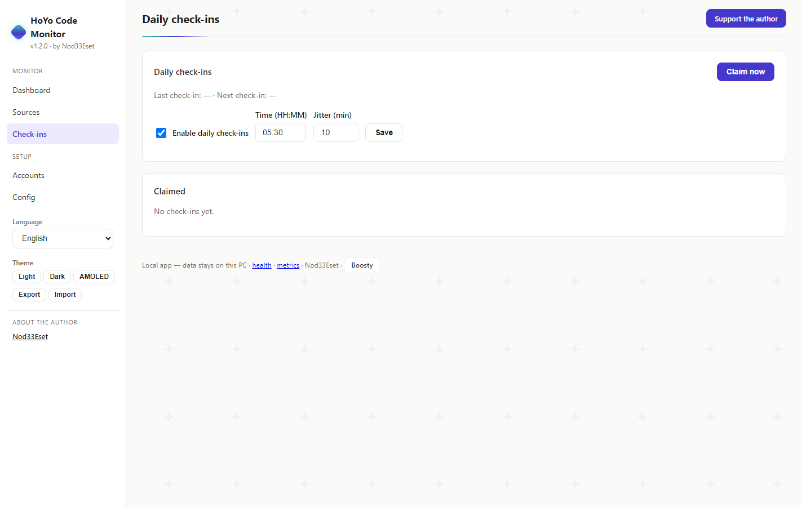

# HoYo Code Monitor

[](https://github.com/retvil/hoyo-code-monitor/releases) [](../LICENSE) [](https://github.com/retvil/hoyo-code-monitor/releases)

[🇬🇧 English](../README.md) | [🇷🇺 Русский](README.ru.md) | [🇺🇦 Українська](README.uk.md) | [🇰🇿 Қазақша](README.kk.md) | [🇩🇪 Deutsch](README.de.md) | [🇫🇷 Français](README.fr.md) | [🇪🇸 Español](README.es.md) | [🇯🇵 日本語](README.ja.md) | [🇵🇱 Polski](README.pl.md) | [🇹🇷 Türkçe](README.tr.md) | [🇨🇳 中文](README.zh.md) | **🇹🇼 繁體中文**

## 這是什麼？

HoYoverse 遊戲經常推出限時促銷碼——而且很快就會過期。**HoYo Code Monitor** 監控 5 款遊戲（原神、崩壞：星穹鐵道、絕區零、崩壞3、未定事件簿）的 23 個代碼來源，並自動將新代碼兌換到您的帳號。所有功能都在您的電腦本機執行：SQLite 資料庫、加密的 Cookie、無遙測、無雲端。

### 運作方式

1. 排程器輪詢已啟用的來源，擷取代碼（`[A-Z0-9]{8,14}`）並儲存新代碼。
2. 對於每個開啟自動兌換的帳號：使用該帳號的 Cookie 呼叫 `GET webExchangeCdkey`，兌換之間有可設定的間隔（預設 8 秒）。
3. 結果記錄：`success` → 完成 + 獎勵；`-2017/-2018` → 已兌換（計為完成）；`-2001` 已過期，`-2003` 無效/僅限中國。
4. 每日 HoYoLAB 簽到依自己的排程執行（預設 04:00 + 隨機延遲）：每個帳號 × 遊戲執行 `info → sign → home`，使用相同 Cookie，結果顯示在「簽到」頁面。
5. 若簽到因 Cookie 過期而失敗，排程器可從已儲存的瀏覽器設定檔**以無頭模式自動重新擷取**（可選開關、每帳號冷卻時間）——只要已儲存的會話仍然有效，就無需手動重新登入。

## 功能

- **背景監控** — 每 N 分鐘檢查來源（可設定，預設 15）
- **自動兌換** — 透過 Hoyolab `webExchangeCdkey` API 兌換新代碼（可選，每帳號）
- **每日簽到** — 為全部 5 款遊戲在 HoYoLAB 自動簽到（可選，每帳號、獨立排程、冪等）
- **多來源** — Wiki、Wiki API、社群 JSON API、攻略網站（23 個預設）
- **多帳號** — 每個帳號有各自的加密 Cookie 和兌換開關
- **自動重新整理 Cookie** — 簽到因 Cookie 過期失敗時，會以無頭模式從已儲存的瀏覽器設定檔重新擷取
- **啟用遊戲篩選** — 排程器會略過帳號未啟用的遊戲
- **來源「啟用中」狀態** — 成功驗證的來源會顯示為「啟用中」
- **統計** — 總計 / 已兌換 / 失敗，依來源分類，兌換記錄
- **Web UI** — `http://127.0.0.1:8000` 的本機儀表板，支援 6 種語言
- **系統匣** — 啟用/停用圖示、掃描間隔子選單、一鍵開啟設定
- **加密 Cookie** — Fernet (AES-128)，金鑰位於環境變數 / 系統金鑰庫 / 本機檔案
- **深色主題** — 側邊欄的淺色/深色切換；選擇依瀏覽器儲存
- **自動啟動** — 登入 Windows 時啟動（預設開啟）

## 螢幕截圖

<details>
<summary>儀表板 / 來源 / 設定 / 簽到 / 帳號 / 關於作者</summary>

| 儀表板 | 來源 | 設定 |
|---|---|---|
|  |  |  |

| 關於作者 |
|---|
|  |

| 簽到 | 帳號 |
|---|---|
|  |  |

</details>

## 來源（已實測驗證）

| 來源 | 類型 | 狀態 |
|---|---|---|
| Genshin Wiki (Fandom) | CSS | May return 403 (Fandom protection) |
| Genshin Wiki API | JSON | Working |
| `hoyo-codes.seria.moe` | JSON API | Working |
| `api.ennead.cc` (x2 endpoints) | JSON API | Working |
| Pocket Tactics, TheClick, Eurogamer, MMO Culture, Playnforge | CSS guides | Working |

## 從安裝程式安裝

從 [GitHub Releases](https://github.com/retvil/hoyo-code-monitor/releases) 下載最新版本：

| 檔案 | 說明 |
|---|---|
| `hoyo-code-monitor-X.Y.Z-setup.exe` | Inno Setup 安裝程式（目前使用者，無需管理員權限） |

### 互動式安裝

1. 執行 `.exe` — 會詢問安裝位置
2. 點擊**下一步** — 包含兩個元件：桌面捷徑和 Windows 自動啟動
3. 點擊**安裝** — 約 30 秒完成。應用程式會在系統匣中啟動。

### 靜默安裝（指令碼 / GPO / SCCM）

```powershell
# Per-user install, no prompts
hoyo-code-monitor-1.5.3-setup.exe /S

# Install to a specific directory
hoyo-code-monitor-1.5.3-setup.exe /S /D=C:\Games\HoYoMonitor

# No desktop shortcut, no autostart
hoyo-code-monitor-1.5.3-setup.exe /S /desktop=no /startup=no
```

### 解除安裝

- **控制台** → 程式和功能 → "HoYo Code Monitor" → 解除安裝
- **靜默**：`uninstall.exe /S`
- 或刪除安裝資料夾及登錄機碼 `HKCU\Software\HoYoCodeMonitor`

### 資料位置（解除安裝/重新安裝後仍保留）

| 項目 | 位置 |
|---|---|
| SQLite database | `%LOCALAPPDATA%\HoYoCodeMonitor\monitor.db` |
| `config.toml` (settings, source definitions) | `%LOCALAPPDATA%\HoYoCodeMonitor\config.toml` |
| Encrypted Fernet key | OS keyring (Windows Credential Manager) |
| Logs | `%LOCALAPPDATA%\HoYoCodeMonitor\logs\` |
| Browser profile (Playwright Chromium) | `%LOCALAPPDATA%\HoYoCodeMonitor\browser-profile\` |

> 進行主要版本升級前，請備份 `data/` + `config.toml`。

## 快速開始

```powershell
# 1. Install and launch - the app lives in the system tray
# 2. Add an account (region: os_usa / os_euro / os_asia / os_cht)
hoyo-code-monitor accounts add main <UID> <REGION>

# 3. Capture cookies once (browser opens, you log in once)
hoyo-code-monitor accounts login main

# 4. Enable auto-redeem (or toggle per account in the Web UI)
hoyo-code-monitor config set redemption_enabled true
```

5. Open the dashboard: `http://127.0.0.1:8000`

## 從原始碼安裝

需要 Python 3.11+（[python.org](https://python.org)）。

```powershell
pip install -e .
# Playwright browser for JS-rendered sources (optional)
python -m playwright install chromium
```

在系統匣執行（建議）/ 單次檢查 / Web UI：

```powershell
hoyo-code-monitor tray
hoyo-code-monitor run-once
python -m uvicorn src.web_ui:app --host 127.0.0.1 --port 8000
```

## 常見問題

- **代碼卡在 Pending？** 檢查 Cookie（會過期）、`redemption_enabled`、帳號開關，以及兌換記錄中的錯誤。
- **`-1071 "Please log in"`？** 重新執行 `accounts login` — Cookie 集不完整。
- **資料在哪裡？** `data/monitor.db`、`config.toml`、`logs/`、`data/.key`。備份請複製 `data/`。

## 作者與支援

請見應用程式儀表板中的「關於作者」區塊，或下方：

**加密貨幣：**

- BTC: `bc1qunld3rsp37qf5gg69aune50y0qqkd0eugg7j97`
- TON: `UQDmvr4SKOxSION3Yky6aOgzAnCDXySPuAbG4EKJa5JUT7tC`
- USDT (TRC20): `TBPJSSLu1mUcX54g9UyxUohYGf2fuRvbwd`
- USDT (ERC20): `0x25CAED3776Ef5b18E03392bC5b254Bbd78E8180C`
- USDT (SOL): `3qgN5z291CEcj2FUi2Zza5DioxKgNw72kC7P52pCcTrG`

## 授權條款

MIT
